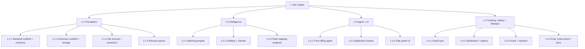

# AI Job Search Copilot: Implementation Plan

Mode: orchestrated unlazy tree, depth 3, scope `job-copilot`, sequential dispatch (contract revision 2).

- Design: [design.md](design.md)
- Plan and contract: [PLAN.md](../.unlazy/job-copilot/PLAN.md)
- Root gates: [GATES.md](../.unlazy/job-copilot/GATES.md)
- Gate oracles: [scripts/gates/](../scripts/gates/)

`.unlazy/` is local and gitignored, as unlazy requires, so the PLAN and GATES links work only in this checkout.

## Tree



## Execution order

One leaf at a time. Each branch runs its integration ledger and must be verified before the next branch starts.

| Order | Leaf | What ships | Est. effort |
|---|---|---|---|
| 1 | 1.1.1 Backend scaffold + contracts | FastAPI, shared Pydantic models, LLM wrapper with mock mode, in-memory cache and delimiting, metadata-only logs, CORS, Docker, CI, open source files | 1 week |
| 2 | 1.1.2 Extension scaffold + storage | WXT, React, Tailwind, Dexie (profile, applications, resumes), Zod mirrors, message union, API client, test toolchain | 1 week |
| 3 | 1.1.3 Job sources + extraction | Adzuna, Greenhouse and Lever fetchers, SQLite cache, dedup, daily refresh, `/jobs/extract` | 1 week |
| 4 | 1.1.4 Resume parser | PyMuPDF extraction, structured parse with one retry, stable bullet ids, `/profile/parse` | 1 week |
| | node-1.1 | Response snapshots checked against the Zod mirrors, no-persistence canary, delimiting audit | |
| 5 | 1.2.1 Matching engine | Hard filters, embedding recall, rerank, fit score computed in code, `/jobs/search` | 1 week |
| 6 | 1.2.2 Drafting + checker | Cited draft, claim extraction, evidence retrieval, judge, rewrite offer, `/draft` | 1 to 2 weeks |
| 7 | 1.2.3 Field mapping endpoint | `/fill/map-fields` with email and URL output validation | 2 to 3 days |
| | node-1.2 | Search-to-draft end to end, snapshots, canary, delimiting audit | |
| 8 | 1.3.1 Form-filling agent | Greenhouse, Lever and generic adapters, fill loop, verify pass, submission detection, no auto-submit | 1 to 2 weeks |
| 9 | 1.3.2 Application tracker | Application records, status history, no_response sweep, tracker table | 3 to 4 days |
| 10 | 1.3.3 Side panel UI | Profile upload and review, ranked jobs, add a job from the active tab, draft highlights, fill review | 1 week |
| | node-1.3 | Playwright fill-to-track flow with the extension loaded, backend-only network check. **MVP complete.** | |
| 11 | 1.4.1 Gmail sync | OAuth, targeted sync on alarms, `/email/classify`, threshold with confirmation, no stored bodies | 1 week |
| 12 | 1.4.2 Dashboard + options | Tracker table, analytics charts, backend URL, privacy controls, export, delete-all | 1 week |
| 13 | 1.4.3 Safety | Scam rules plus classifier, injection detection, draft output validation, side panel warnings | 1 week |
| 14 | 1.4.4 Eval, mock portal + docs | Mock portal, seven evaluations with baselines, README, privacy policy | 1 to 2 weeks |
| | node-1.4, then root | Gmail-to-dashboard flow, form-agent evaluation, bundle secret scan, security review, final audit | |

Total: roughly 14 to 16 weeks solo. Sequential execution trades some calendar time for simpler ownership and no merge work.

## How the gates work

- Every runnable gate calls [check.mjs](../scripts/gates/check.mjs) (pytest, vitest, playwright, typecheck) or [oracles.mjs](../scripts/gates/oracles.mjs) (static and smoke rules). [selftest.mjs](../scripts/gates/selftest.mjs) proves each oracle fails on a known-bad fixture and passes on a clean one.
- Gates never call a live model or job API. `check.mjs` forces mock LLM, fake embeddings and scheduler off, strips API keys from the environment, and limits pytest to localhost. Model quality is measured only by the evaluation suite.
- The driver writes each leaf's acceptance tests before dispatching it. A leaf cannot edit them: every leaf's G0 (`oracles.mjs owns-diff`) fails if the leaf touched any file outside its `OWNS:` since its `unlazy/leaf-<id>/start` tag.
- Branch ledgers start with a runnable N1 that re-verifies every child. Root `GATES.md` re-verifies every branch, runs the plan consistency check, and re-scans for auto-submit, personal-data persistence and non-goal violations.
- 129 of the 140 gates are runnable. The 11 manual gates are owner reviews: UX, security, datasets, README and privacy policy, the Gmail OAuth check, live evaluation, release, and the final non-goals review.

Commands, run from the repository root:

```bash
node scripts/gates/selftest.mjs
```

```bash
node scripts/gates/oracles.mjs plan
```

```bash
node .agents/skills/unlazy/scripts/gate-check.mjs --root . --cwd . --timeout 900 --reverify .unlazy/job-copilot/gates/leaf-1.1.1.md
```

Node ledgers use `--timeout 3600` and the root uses `--timeout 14400`, because approvals bind the timeout.

## Key design decisions enforced

| Decision | Enforced by |
|---|---|
| The browser is the trust boundary | In-memory-only LLM cache and metadata-only logs (leaf-1.1.1:G5, G7), canary checks at node-1.1:N4, node-1.2:N6, node-1.3:N3 and GATES:G5 |
| A pipeline, not an autonomous agent | The LLM wrapper passes no tools or functions (GATES:G6) |
| A human submits every application | Behavioral check leaf-1.3.1:G4 and the source scan at leaf-1.3.1:G5, node-1.3:N4 and GATES:G4 |
| Every claim traces to the resume | leaf-1.2.2:G1 to G5 and node-1.2:N2 |
| Provider-agnostic and self-hostable | leaf-1.1.1:G3, G4 and G9 |

## Owner prerequisites

1. Docker Desktop running, for leaf-1.1.1:G9.
2. `npx playwright install chromium` in `extension/` after leaf 1.1.2.
3. A Google Cloud OAuth client and a fixed extension key, for leaf-1.4.1:G1.
4. An LLM key or local Ollama, plus Adzuna credentials, for live use and the live evaluation run. Runnable gates never need them.
5. Read and approve each oracle once with `--approve`.

## Decisions needed from the owner

These rows are `OWNER_DECISION` in the PLAN inventory and block root completion until decided:

- **C32, portal-page status reading** (design §10.3): reading the LinkedIn applied-jobs list needs a LinkedIn host permission that §6.4 excludes. Either add it as an optional permission or drop the feature.
- **C33, model choice on the options page** (design §6.1): models are backend config, so the options page needs either a backend override API or a display-only view.

The license defaults to MIT. Say so if you prefer Apache 2.0.

Open questions from design §16 that do not block the plan:

1. **Indian job sources beyond Adzuna**: amend leaf 1.1.3 if a partner API turns up.
2. **Hosted vs self-hosted backend**: the plan builds self-hosting. A hosted instance needs no new code but carries running cost.
3. **Email auto-update threshold**: configurable in leaf 1.4.1 and set from evaluation results at leaf-1.4.4:G6 (inventory C30).
4. **Multiple resume versions**: v1 keeps one profile.

## Next step

Before leaf 1.1.1 can start:

1. Make the initial commit of the repository.
2. The driver writes the leaf-1.1.1 acceptance tests and design-sample fixtures, commits them, and tags `unlazy/leaf-1.1.1/start`.
3. Read and approve the leaf-1.1.1 oracles.
